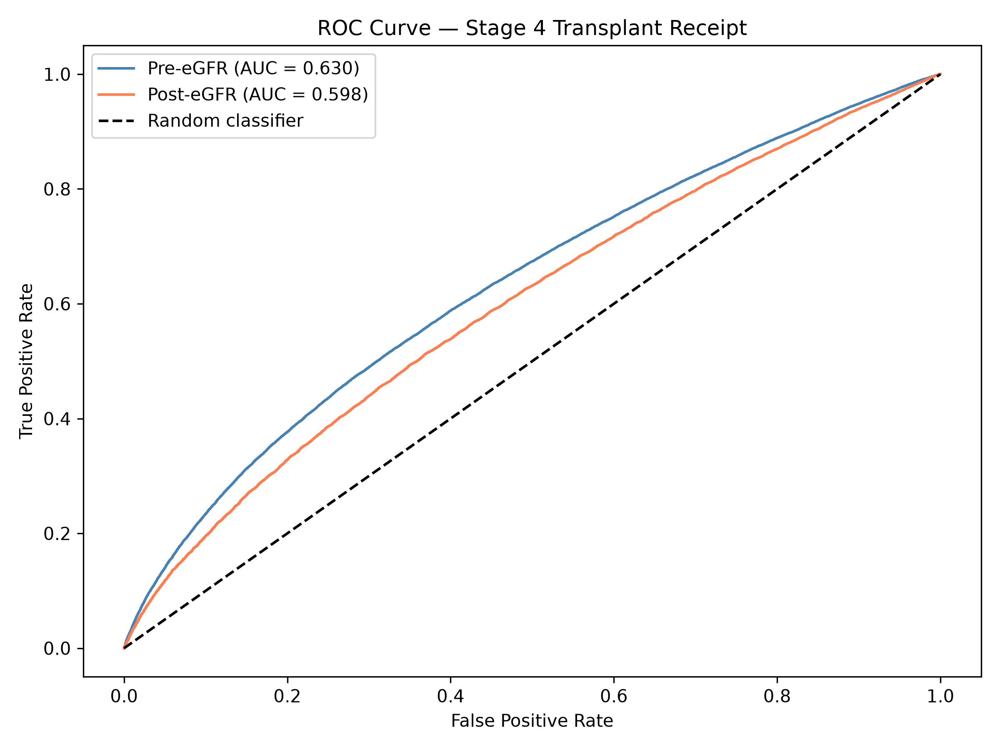

#  Racial and Insurance Disparities in Kidney Transplantation
Georgia Tech OMSA Applied Practicum · Sponsor: Mickey Dale Family Foundation Team: Elizabeth Samuel, Kevin Yu, Joshua Roach

**Data note:** This analysis uses Scientific Registry of Transplant Recipients (SRTR) Standard Analysis Files. The data is available through the SRTR under a data use agreement and is not included in this repository.

[Adjusted odds ratios for transplant receipt](images/forest_plot_stage4.png)
## Overview

Getting a kidney transplant isn't one decision. It's a series of hurdles: getting referred, getting on the waitlist, staying active on it, and finally receiving an organ. Our sponsor wanted to know whether race and insurance status independently predict how far patients get, even after accounting for how sick they are.

We also compared patients listed before and after the 2022 race-neutral eGFR mandate, which removed a race-based adjustment that had made Black patients' kidney disease look less severe than it was.

## My role

I worked on a three-person team where each of us owned one stage of the pipeline, and together we built the cross-stage synthesis. I owned Stage 4, transplant receipt: data cleaning, merge strategy, feature engineering, modeling, sensitivity analysis, and visualizations. I also wrote the data, methods, and results sections for that stage.

## Data
- SRTR Standard Analysis Files covering every U.S. kidney waitlist candidate and transplant recipient (`cand_kipa`, `tx_ki`)
- Restricted to listings after the December 2014 Kidney Allocation System reform, so all records fall under the same allocation rules
- Kidney-only registrations (kidney-pancreas and pancreas-alone listings excluded)
- About 370,000 patients with known outcomes in the Stage 4 analysis

## Approach (Stage 4)
 
- **Outcome variable:** built a binary `RECEIVED_TX` flag from waitlist removal codes, excluding patients removed in error or transplanted abroad
- **Merge:** joined the waitlist and transplant files on patient ID with a left join, keeping all resolved waitlist patients; documented a linkage gap in older records as a limitation
- **Policy era split:** divided patients into pre- and post-reform cohorts at September 2021, when the race-free eGFR equation was recommended and centers began adopting it, rather than at the July 2022 mandate date
- **Models:** fit separate logistic regression models for each cohort (one-hot encoded categoricals, standardized features), so the effects of race and insurance could differ between eras
- **Sensitivity analysis:** re-ran both models treating still-active waitlist patients as non-recipients to test robustness

## Key findings
 
- **Disparities compound across the pipeline.** A Black patient on Medicaid was less likely to be listed before starting dialysis, waited longer after starting dialysis to reach the waitlist, and had lower odds of ever receiving a transplant, even after accounting for clinical factors.
- **The policy fix helped unevenly.** The extra active waitlist time for Black candidates dropped from about 30% to about 6%, but referral delays barely moved. Black patients still waited about 114 more days to get listed after starting dialysis.
- **Insurance mattered at every stage.** Private insurance was associated with higher odds of transplant receipt in both eras (OR 1.093 pre-reform, 1.045 post-reform, vs. Medicaid), though the advantage shrank after the reform.
- **The raw numbers can mislead.** Unadjusted, White Medicaid patients had a lower transplant rate (65.5%) than Black Medicaid patients (67.4%). That reversal likely reflects differences in age and medical complexity, which is why adjusted modeling matters for equity questions.

## Model performance
 

 
ROC-AUC was 0.630 pre-reform and 0.598 post-reform. Moderate discrimination is expected here: organ availability and waitlist dynamics drive much of the outcome and aren't captured in patient-level data. The goal was to explain disparities, not to predict who gets a transplant.

## Limitations and next steps
 
- Post-reform results shifted in the sensitivity analysis because many recently listed patients hadn't had time to receive a transplant yet, so they should be read with caution until more follow-up data is available.
- The reference category for race in Stage 4 was Asian patients (from the encoding order), so Black–White comparisons are clearer in the earlier stages.
- Next steps would be joining the three stages into one end-to-end pipeline, building a dashboard that lets the sponsor filter by region, and monitoring for drift as new policies take effect.

